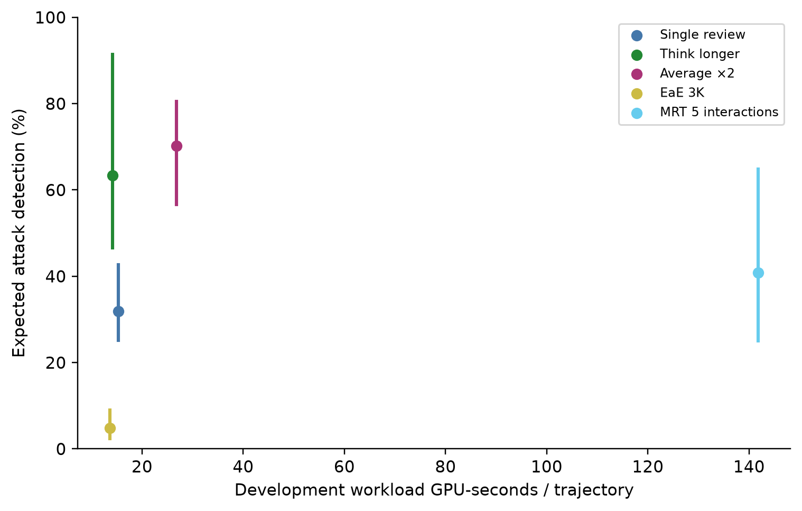
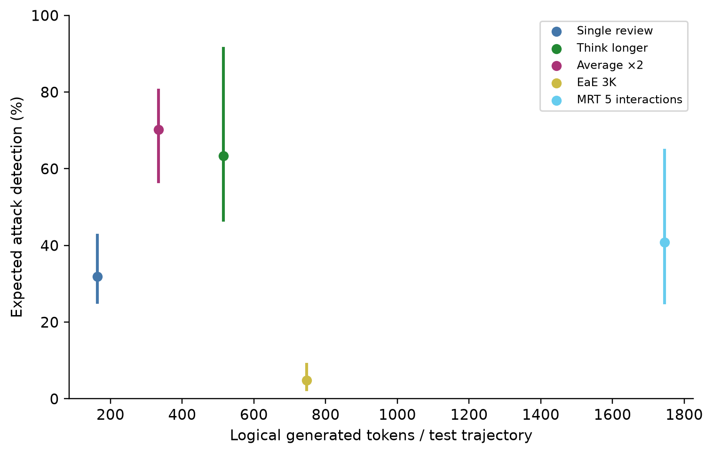

# Compute efficiency

| Method | Dev GPU s/trajectory | Cost / single | Logical calls | Cache-hit calls | Input tokens/trajectory | Generated tokens/trajectory | Estimated reasoning tokens/trajectory |
| --- | --- | --- | --- | --- | --- | --- | --- |
| Single review | 15.30 | 1.00 | 573 | 0 | 23646.3 | 163.8 | 44.6 |
| Think longer | 14.18 | 0.93 | 581 | 0 | 24007.0 | 515.2 | 406.5 |
| Average ×2 | 26.77 | 1.75 | 1147 | 573 | 47330.5 | 334.3 | 96.8 |
| EaE 3K | 13.67 | 0.89 | 1153 | 1 | 28561.9 | 747.6 | 656.4 |
| MRT 5 interactions | 141.81 | 9.27 | 6326 | 0 | 63664.8 | 1745.7 | 479.7 |

| Budget | GPU s limit | Single review | Think longer | Average ×2 | EaE 3K | MRT 5 interactions |
| --- | --- | --- | --- | --- | --- | --- |
| large | 141.81 | available | available | available | available | available |
| small | 30.60 | available | available | available | available | unavailable |

GPU costs are the frozen independent homogeneous development workload measurements (40 records per method, one H200, concurrency one), not held-out allocated GPU time. Token and call totals refer to the 572 primary test trajectories and include logical retries and cache reuse. Reasoning-token counts were not exposed by the server; the reported nonzero reasoning values are local estimates, not additional tokens to add to total generation. A recorded zero in the server reasoning-total field means unavailable measurement here, not no reasoning.

MRT costs 5.30 times averaging in development. It has a lower detection point estimate and higher realized test FPR. Its observed cost-performance position is dominated descriptively by averaging; neither precise held-out cost equivalence nor cost uncertainty is established. Think-longer is slightly faster than single review in the one development measurement, despite generating more tokens on test. Timing variability and serving effects remain possible explanations; the saved aggregates cannot identify a cause.

Slurm accounting confirms 60.614 allocated GPU-hours against the 90-hour cap. Startup and failed allocations belong in that total; startup is separate from homogeneous workload rates. Request latency sums cannot substitute for GPU allocations or be divided among methods as allocation estimates. No repeated cold trials are available to support horizontal error bars.

*Measured development workload cost versus frozen test detection; vertical intervals are task-bootstrap uncertainty, with unequal realized test FPRs.*

*Logical generated tokens per primary test trajectory versus detection; tokens are a workload proxy and do not imply equal GPU time.*

The point-estimate frontier in development GPU cost and expected test TPR contains Think longer, Average ×2, EaE 3K. This descriptive two-axis frontier ignores cost uncertainty and unequal realized test FPR; frontier membership is not an inferential superiority claim.
