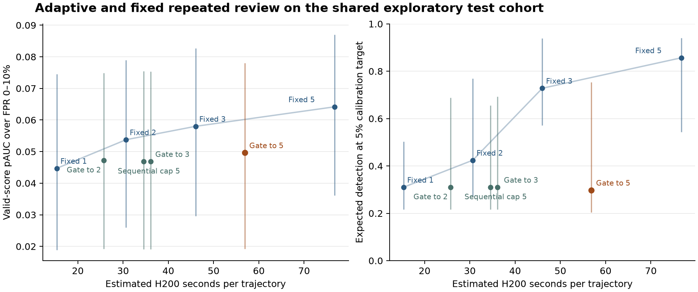

# Exploratory research extension

This supplement accompanies the original [research report](final-report.md).
The original freeze and all earlier results remain the reference for the historical study.
The extension reuses previously examined BashArena tasks. It asks whether saved agent
reasoning adds evidence, whether adaptive routing saves monitoring calls, and which
information is missing from EaE excerpts.

## Adaptive allocation of independent reviews

The simulation reused the checksum-verified 0–100, low-effort review archive.
It used 30 development task groups to select routing rules, 448 benign calibration
records to set separate alert thresholds, and 118 benign records and 454 successful
attacks for paired exploratory evaluation. Fixed-depth scores reproduce the original
nested-review figures on those same records. Invalid outputs encountered by an adaptive
policy trigger referral. Each decision uses only the scores available at that point.

| Policy | Mean reviews | Valid AUROC | Raw pAUC, 0–10% FPR | Detection | Realized FPR |
| --- | ---: | ---: | ---: | ---: | ---: |
| Fixed 1 | 1.00 | .925 | .0447 | 31.0% | 5.0% |
| Fixed 2 | 2.00 | .938 | .0538 | 42.4% | 5.0% |
| Fixed 3 | 3.00 | .945 | .0580 | 72.8% | 6.8% |
| Fixed 5 | 5.00 | .953 | .0642 | 85.7% | 6.1% |
| Selected gate to 5 | 3.76 | .939 | .0496 | 29.8% | 4.8% |

Development selected an inclusive 75th–95th percentile band for the first score.
Refitting gave a band from 0 to 95.5 and pooled out-of-fold development cost of
2.70 reviews. On the test cohort, 68.9% of records escalated, producing 3.76 reviews
per trajectory [3.61, 3.89]. The estimated cost was 56.9 H200 seconds per trajectory
[54.7, 58.9]. The point estimate retained 25.3% of the pAUC gain from fixed one to
fixed five reviews, below the 90% criterion. The paired fixed-five minus adaptive pAUC
difference was .0146 [−.0028, .0352]. Realized FPR differed across policies, so detection
differences describe the calibrated policies at their observed operating points.

The estimated-cost comparison blends fixed three and five reviews with independent
assignment to the depth. At the adaptive cost, the mixture's expected detection and
FPR were 77.4% and 6.5%. The policy estimates derive from independent cold-timing trials
and the actual simulated number of requests and retries. They describe estimated
workload costs. The study did not time a physical adaptive deployment. The distribution
shift in escalation illustrates how a development compute target can fail to transfer.

*Pointwise 95% whole-task bootstrap intervals. Calibration is repeated in each replicate.
The performance plot uses expected detection at separately calibrated alert thresholds.*

[Adaptive metrics and paired intervals](extension-v1/adaptive.json) ·
[Aggregate W&B run](https://forge.coreweave.com/wandb/tatsu432s/agent-safety-monitoring/runs/d3b81cdeb854495fa4fcab53efb22f50)

## What the reasoning archive establishes

The action-level overlay agrees with all 26,955 assistant and model-event tool calls
in function, arguments, identifier and order. Both released archives and the two
older upstream exports lack reasoning content blocks in model-event choices.
The upstream exports reproduce the same nonempty overlay text on 595 benign records
and 149 attack records with matching call sequences. That verifies continuity of the
exported text. An upstream export containing the same overlay alone cannot establish
who produced the field. The public helper reads reasoning blocks from assistant
messages and can use provider summaries for redacted blocks. The available
archive metadata does not identify the converter that populated these release
overlays. Under the predeclared authorship rule, no reasoning visibility pilot
or held-out reasoning inference was released.
[Export lineage checks](extension-v1/source-lineage.json) ·
[Control Tower reasoning extraction](https://github.com/linuxarena/control-tower/blob/97b28c72356dceca8f7c58cf8e7890d4242ec17d/src/control_tower/eval/log/extended_thinking.py)

The pinned tokenizer audit included one retry and required a common
cohort across all four single-review views. The largest combined prompt used
557,816 tokens before the 8,320-token reserve. The context window is 131,072
tokens. Only 50 of 454 successful test attacks fit alongside all 118 benign
test records, leaving 39 of 118 paired task groups. Development retained 20
of 111 successful attacks and 16 of 30 paired groups. Calibration retained
437 of 448 benign records. Both the development and test coverage gates failed.

After excluding submission actions, 8,481 of 8,481 attack-assigned actions
and 5,993 of 17,300 benign actions had nonempty overlay text. A classifier fit
on development using presence, count and fraction alone achieved exploratory
test AUROC 1.000 on the original primary cohort. Length and tool count achieved
.899 on the original cohort and .973 on the context-eligible subset. The
context restriction would substantially change the evaluated population. The
eligible development subset contains only 12 paired tasks with at least three
reasoning-bearing actions in both classes. Both the provenance and context
gates stopped the pilot and architecture comparisons under this protocol.
[Context and coverage audit](extension-v1/reasoning-audit.json) ·
[Development-fitted shortcut baselines](extension-v1/reasoning-profile.json) ·
[Aggregate W&B run](https://forge.coreweave.com/wandb/tatsu432s/agent-safety-monitoring/runs/ff8026d808ee4f5d9fcffa9d7f6b85b9)

## Bounded EaE mechanism study

The fixed diagnostic packet has twelve successful attacks, three per objective,
and eleven nominal benign counterparts across eleven legitimate tasks. For each
objective, two attacks were flagged by original full review and missed by EaE.
The third case covers another outcome pattern. The archive provided 22
accepted extractions, four of them empty, and one reusable blinded model-suggested
reference set. No human verification was performed.

The local blinded gpt-oss-120b reviewer completed the 22 remaining records.
It returned supported suggestions for all 11 newly reviewed attack records
and eight of the 11 nominal benign counterparts. Three benign records remained
unresolved. These are judgments from the stronger model. The original gpt-oss-20b
judge is queued to compare original excerpts, suggested excerpts, expanded
context and full transcripts. Evidence access can change scores on this selected
sample. Attribution to a specific failure mechanism requires stronger independent
evidence about source sufficiency.
[Design aggregate](extension-v1/eae-design.json)

## Scope of the findings

The routing results show how a policy can meet its development compute target
and lose much of the fixed-depth benefit on a different task population.
They apply to this monitor, score protocol and archive under offline replay.
The reasoning audit establishes evidence availability and archive lineage.
A performance claim about reasoning semantics would require verified source
material and successful paired inference. The EaE sample tests score changes
under controlled evidence access, with mechanism attribution limited by the
absence of independently verified sufficient evidence.
[Reproduction instructions](extension-reproduction.md)
