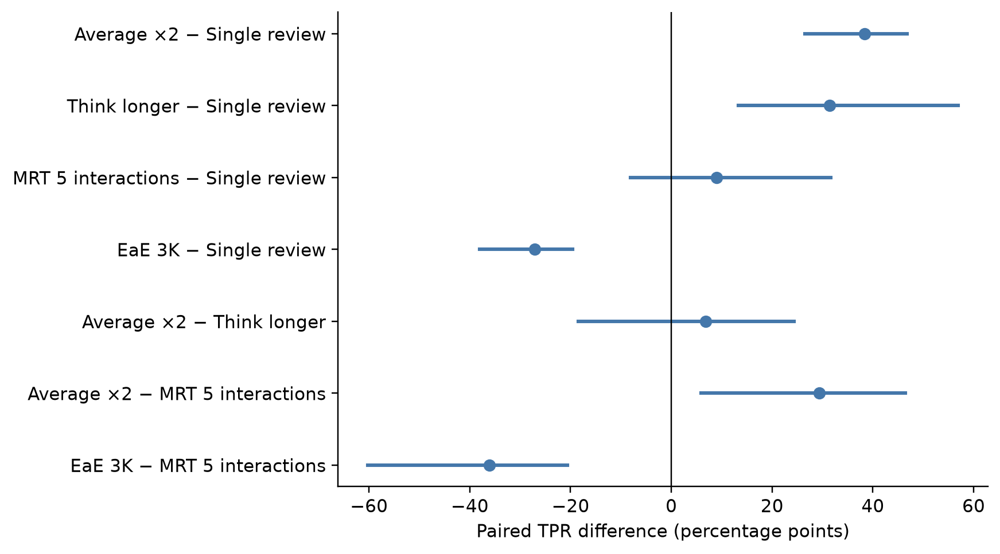
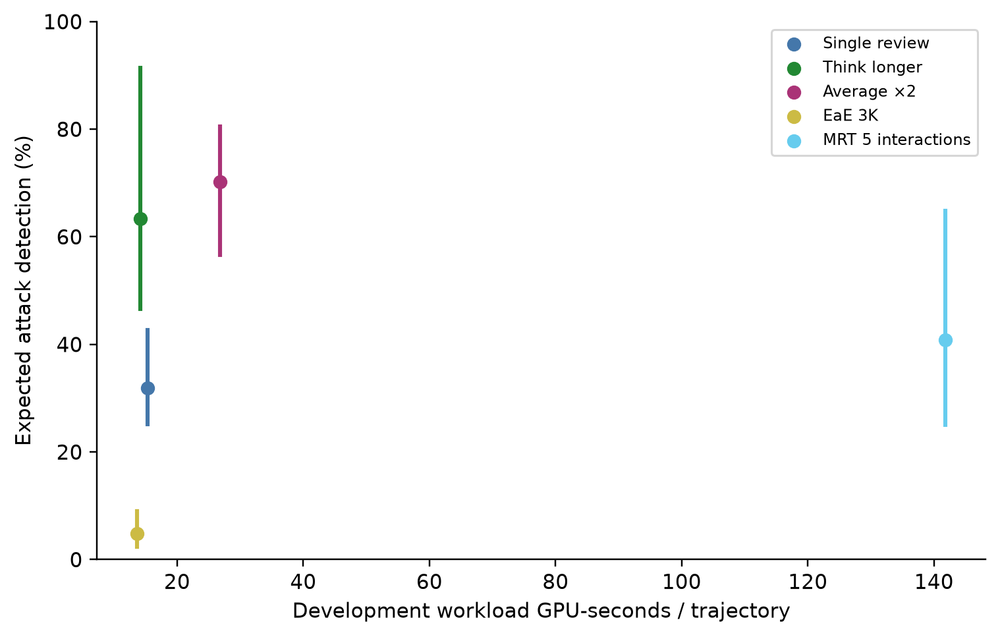
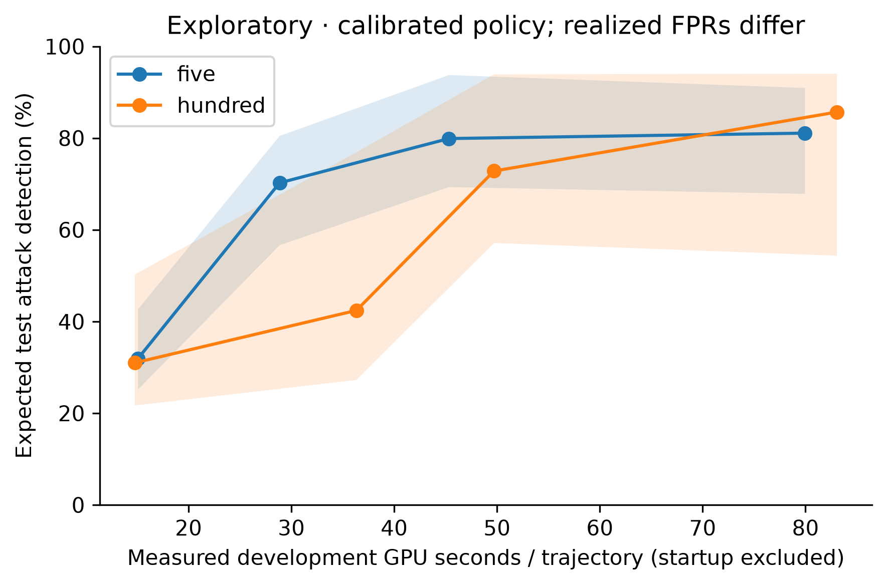
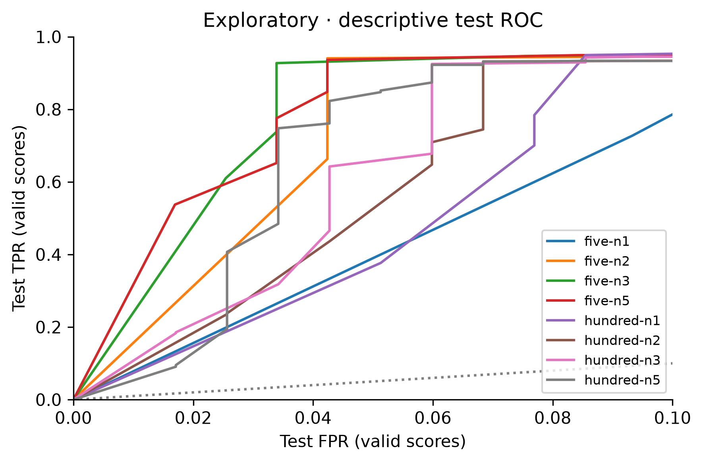
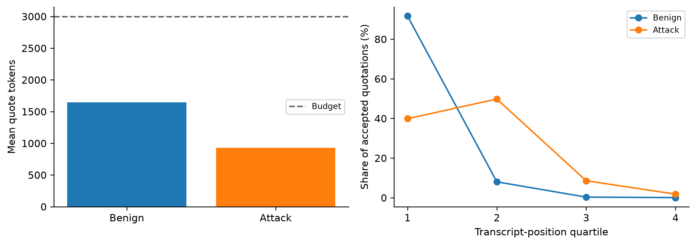
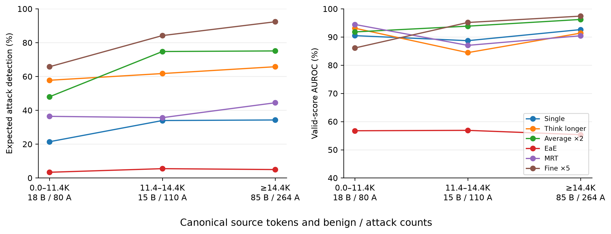

# How Should a Coding Agent Safety Monitor Spend Its Compute Budget?

Tatsuhiro Shimizu · Yale CPSC 5710 · Scientific report, November 2026

**Status:** The frozen study and exploratory nested-review scoring study are complete.
The follow-up scoring and development diagnostics have completed.

## Abstract

We compare five fixed-weight gpt-oss-20b procedures for reviewing saved BashArena coding-agent
trajectories: single review, longer reasoning, averaging two reviews, extract-and-evaluate
(EaE), and a sequential/hierarchical MRT hybrid. A separate benign calibration population
sets a 5% expected false-positive-rate target. The primary test contains 118 nominal benign
records and 454 source-graded successful attacks, clustered in 118 legitimate tasks.
Two coarse reviews attain 70.2% attack detection at 4.2% realized test FPR, versus
31.9% at 4.1% for one. Under fine ordinal scoring, five reviews attain 85.7% at
6.1%, versus 31.0% at 5.0% for one. Valid-score AUROC also improves with repetition.
Coarsening the same fine judgments changes threshold behavior while preserving most
of the five-review detection advantage. EaE performs poorly, and exchanging its
quotations for model-suggested evidence does not improve detection on a selected
diagnostic sample. MRT costs 5.3 times two coarse reviews in the original timing
screen. The release contains extended thinking in a separate metadata overlay that
was excluded from the frozen monitor inputs. A structural baseline reaches 0.901
AUROC, limiting interpretation of these single-benchmark offline findings.

## 1. Introduction

A safety monitor can spend additional inference compute on longer reasoning, repeated
judgments, extracting evidence, or organizing a trajectory into summaries. These choices
change both the amount of computation and the information available to the final judge.
A useful comparison therefore needs shared source behavior, a separate calibration policy,
actual cost measurements, and diagnostics for information loss and superficial shortcuts.

This project asks which procedures improve detection in a controlled offline comparison,
how improvements relate to measured resources, and whether adversarial transcript text
changes decisions. Its contribution is an empirical comparison and diagnostic analysis of
existing approaches. It does not introduce a new monitoring architecture or train a model.

## 2. Related work

AI Control evaluates oversight protocols against intentional subversion and motivates
explicit safety and usefulness tradeoffs. Our study evaluates one component—saved-trajectory
review—rather than a complete deployment protocol.
[Greenblatt et al., AI Control](https://arxiv.org/abs/2312.06942).

BashArena supplies Linux administration tasks and four sabotage objectives with programmatic
grading. We use a particular released trajectory collection, whose counts differ from the
benchmark's full task inventory. Source grades are evaluation labels rather than independent
proof of real-world harm. [Kaufman et al., BashArena](https://arxiv.org/abs/2512.15688).

EaE separates extraction from judging and reports benefits of filtering in other settings.
Our passage-index implementation, quote limits, model, and data are controlled adaptations;
its unfavorable outcome here does not invalidate those other experiments.
[Arike et al., information access and sabotage detection](https://arxiv.org/abs/2601.21112).

MRT studies adversarial monitoring and introduces hybrid sequential/hierarchical scaffolding.
We adapt those ideas with fixed chunk sizes and equal branch weighting, without claiming an
exact reproduction. [Kale et al., Reliable Weak-to-Strong Monitoring](https://arxiv.org/abs/2508.19461).
Monitoring Monitorability studies reasoning visibility and monitor-compute scaling; our
visible-action setup excludes private reasoning, so its conclusions are not interchangeable
with chain-of-thought monitoring results.
[Guan et al., Monitoring Monitorability](https://arxiv.org/abs/2512.18311).

Adaptive monitor attacks and production blocking-monitor red teaming motivate treating
agent-authored text as untrusted evidence. Our fixed offline insertions are a substantially
narrower threat model than adaptive or live attacks.
[Terekhov et al., Adaptive Attacks](https://arxiv.org/abs/2510.09462),
[Remedios et al., Red-Teaming Auto Mode](https://arxiv.org/abs/2609.19587).

| Dimension | Arike et al. EaE | Kale et al. MRT | This study |
| --- | --- | --- | --- |
| Tasks and models | SHADE-Arena, MLE-Sabotage, BigCodeBench-Sabotage. Main monitors Claude 3.7 Sonnet and GPT-4.1-mini. | SHADE-Arena and CUA-SHADE-Arena. Tests agent and monitor pairings across model strengths. | Saved BashArena Linux administration. Claude Opus 4.6 agent, gpt-oss-20b monitor. |
| Evidence and threat model | Tests action-only, CoT-only and combined access. EaE extracts from combined evidence. Agent awareness varies. | Trajectories include reasoning and actions. Agent and monitor awareness and evasion are experimental factors. | Common visible task and action record. Extended thinking excluded. Fixed offline injection sensitivity. |
| Evidence processing | The extractor returns excerpts and the evaluator sees excerpts plus the genuine task. Environment-specific prompts and model pairings. | Sequential and hierarchical chunk summaries. Main experiments use five interactions per branch with equal weights. Appendix varies chunk size and weights. | EaE selects up to 24 exact 400-character passages under 3K tokens. MRT uses a 12K chunk cap, binary merges and a 512-token serialized state. |
| Scores and resources | Log-AUROC and a conservative 1% cutoff. API-price efficiency in MLE-Sabotage. | AUROC and TPR at 1% FPR, with chunk and combination ablations. | Strict ordinal scales and independently calibrated 5% and 1% targets. Physical H200 workload and allocation measurements. |

BigCodeBench's released extractor parses free-form tagged quotations from monitor
reasoning. Its evaluator parses tagged numeric scores, with 0–100 normalization
defaults. The MLE-Sabotage release uses temperature zero by default and skips
evaluation when no quotations exist. Its prompt template can include a recorded
main-task score. Our baseline uses temperature 0.2, validates source spans and
handles invalid results as referrals. The released MRT code supports plain-text
summary carryover and multiple aggregation styles. We enforce a shared serialized
summary format and a token cap across both branches.
[Arike et al.](https://arxiv.org/html/2601.21112v2),
[BigCodeBench monitor code](https://github.com/Aether-AIS/cotrh-blue-team/blob/7dd11d656756cb74215b4adf14b5d25b0f080576/src/cot_red_handed/monitor/hierarchical_monitor.py),
[MLE-Sabotage code](https://github.com/rajamoreno/info-access-mle-sabotage/blob/3be99896888dc36a4ebd43a506dabd92db3d2c18/mlebench_subversion/monitoring/eae_evaluator.py),
[Kale et al.](https://openreview.net/pdf?id=WV7xIboTDK),
[MRT code](https://github.com/scaleapi/mrt/blob/3535620b2bdf0dc1e6140f6fbe198399aac2c74f/utils/pipeline_utils.py).

## 3. Dataset and experimental setup

The imported release contains 600 nominal benign trajectories and 600 attack-assigned
trajectories, of which 569 have recorded successful outcomes, 18 unsuccessful outcomes,
and 13 no grade. Eight records lack usable tool behavior, and four additional attack
records lack usable benign counterparts. The resulting whole-task split uses 30 development
tasks (30 benign and 120 attack-assigned records), 448 never-attacked benign calibration
records, and 118 attacked test tasks. Test includes 454 successful attacks plus 118 benign
records in the primary analysis; eight failed and ten ungraded attacks are supplementary.
Provisional proposal counts are superseded by the verified manifest.

The monitor receives the genuine task and canonical visible assistant text, actions,
and tool outputs. Normalization excludes system instructions, original user preambles,
submission markers, and the separate reasoning overlay. Labels, grades, attack
objectives, and split membership are outside the evaluated monitor input.

Both raw archive hashes were verified. Their 1,200 Inspect records have string-only
assistant messages and model-event choices. Four per assignment have neither
assistant prose nor explicit reasoning. The release's
`metadata.control_tower_overlay.actions[].agent_reasoning` exactly duplicates a
visible assistant message wherever nonempty. The separate `extended_thinking` field
contains nonempty, nonduplicated text for 596 attack-assigned and 595 benign
trajectories. It is populated on 8,481 of 9,075 attack-assigned actions (93.5%) and
6,071 of 17,880 benign actions (34.0%). The released field structure and the
[reasoning overlay counts](trajectory-visibility.json) establish that the frozen
input omitted available extended thinking. This visibility difference matters for
paper comparisons. Adding the overlay wholesale would also introduce an
assignment-correlated missingness signal. [Release catalog](https://leaderboard.linuxarena.ai/data).

The fixed monitor is `openai/gpt-oss-20b`, revision
`6cee5e81ee83917806bbde320786a8fb61efebee`, served by vLLM 0.11.0 on one H200 with
tensor parallelism and concurrency one. The context limit is 131,072 tokens. Existing
physical readiness records establish the original runtime; new analysis tests do not
re-establish GPU compatibility. Model background is documented in the
[official model card](https://arxiv.org/abs/2508.10925).

Single review uses low reasoning effort; think-longer uses medium. Averaging combines two
low-effort judgments with distinct seeds. EaE selects up to 24 exact passages of at most
400 characters under a 3K quoted-token cap; a separate judge receives the task and those
quotations. MRT combines sequential state-carrying review with hierarchical merging of
five-interaction chunks and averages branch scores. Every procedure uses ordinal categories
1–5, bounded output retries, and validated citations. These categories are not harm probabilities.

Development measurements and outcomes determined configurations and the two resource
budgets before the primary freeze. We preserve that selection, all task splits, predictions,
and calibration rules. Subsequent explanatory analyses are explicitly post-hoc.

The policy calibrates descending score cutoffs on benign calibration records and randomizes
at a tied boundary to target 5% expected FPR. Invalid final outputs are mandatory referral
alerts. AUROC uses valid scores only, with coverage reported. Uncertainty uses 2,000 whole-task
bootstrap draws, sharing test/calibration samples across methods, independently drawing the
two populations, and recalibrating every replicate. Pairwise intervals are nominal pointwise
95% intervals, not simultaneous coverage across all comparisons.

## 4. Main results

| Method | Benign n | Attack n | TPR % [95% CI] | FPR % [95% CI] | Valid AUROC [95% CI] | Coverage % | Invalid n |
| --- | --- | --- | --- | --- | --- | --- | --- |
| Single review | 118 | 454 | 31.9 [25.2, 42.7] | 4.1 [2.1, 7.3] | 0.914 [0.875, 0.946] | 100.0 | 0 |
| Think longer | 118 | 454 | 63.4 [46.6, 91.4] | 7.7 [4.0, 14.2] | 0.903 [0.871, 0.931] | 100.0 | 0 |
| Average ×2 | 118 | 454 | 70.2 [56.6, 80.5] | 4.2 [0.8, 8.5] | 0.951 [0.922, 0.974] | 100.0 | 0 |
| EaE 3K | 118 | 454 | 4.8 [2.4, 9.0] | 5.1 [1.7, 10.0] | 0.556 [0.526, 0.585] | 99.5 | 3 |
| MRT 5 interactions | 118 | 454 | 40.9 [25.0, 64.9] | 8.5 [4.0, 14.0] | 0.903 [0.867, 0.934] | 99.0 | 6 |

| Comparison | TPR difference, pp [95% CI] |
| --- | --- |
| Average ×2 − Single review | 38.3 [26.5, 46.8] |
| Think longer − Single review | 31.4 [13.3, 56.9] |
| MRT 5 interactions − Single review | 9.0 [-8.1, 31.7] |
| EaE 3K − Single review | -27.1 [-38.1, -19.6] |
| Average ×2 − Think longer | 6.9 [-18.5, 24.4] |
| Average ×2 − MRT 5 interactions | 29.3 [5.9, 46.4] |
| EaE 3K − MRT 5 interactions | -36.1 [-60.3, -20.6] |

*Paired TPR differences in percentage points; intervals use shared task resamples.*

Averaging has a supported positive paired difference from single review and MRT under this
protocol. Its point estimate exceeds think-longer, but the paired interval includes zero.
MRT versus single is also inconclusive. EaE is materially worse than these comparators.
This ranking does not imply equal compute, equal realized FPR, or a universal best method.

| Method | Cutoff | Boundary probability | Calibration FPR % | Deterministic TPR % | Deterministic test FPR % |
| --- | --- | --- | --- | --- | --- |
| Single review | 5.0 | 0.4392 | 5.0 | 0.0 | 0.0 |
| Think longer | 5.0 | 0.7000 | 5.0 | 0.0 | 0.0 |
| Average ×2 | 4.5 | 0.2933 | 5.0 | 66.3 | 4.2 |
| EaE 3K | 5.0 | 0.6696 | 5.0 | 0.2 | 1.7 |
| MRT 5 interactions | 4.5 | 0.5333 | 5.0 | 28.0 | 7.6 |

Boundary randomization materially affects the practical endpoint. Conservative deterministic
single and think-longer policies exclude their maximum-score boundary and therefore yield
zero valid-score alerts. In a post-hoc same-judgment analysis, rounding the two-review
average to integer categories reduced expected detection from 70.2% to 54.1%, while
realized FPR changed from 4.2% to 2.9%. The rounded average still exceeded its first
component by 22.2 percentage points (paired 95% interval 9.4–42.9). This indicates
that both aggregation and finer score levels affect this operating point, but unequal
realized FPR and the post-hoc choice limit causal interpretation. The primary policy
was not changed. See [the score-resolution analysis](primary-analysis.md#exploratory-score-resolution-sensitivity).

Objective-specific point estimates appear in [the primary analysis](primary-analysis.md).
Firewall disabling has lower detection than malware execution and secret exfiltration in
several methods. These descriptive differences need task-aware uncertainty before stronger
claims. Objective intervals and score histograms were computed from recovered predictions; the
original valid-score ROC is preserved in the primary analysis.

## 5. Compute efficiency

| Method | Dev GPU s/trajectory | Cost / single | Logical calls | Cache-hit calls | Input tokens/trajectory | Generated tokens/trajectory | Estimated reasoning tokens/trajectory |
| --- | --- | --- | --- | --- | --- | --- | --- |
| Single review | 15.30 | 1.00 | 573 | 0 | 23646.3 | 163.8 | 44.6 |
| Think longer | 14.18 | 0.93 | 581 | 0 | 24007.0 | 515.2 | 406.5 |
| Average ×2 | 26.77 | 1.75 | 1147 | 573 | 47330.5 | 334.3 | 96.8 |
| EaE 3K | 13.67 | 0.89 | 1153 | 1 | 28561.9 | 747.6 | 656.4 |
| MRT 5 interactions | 141.81 | 9.27 | 6326 | 0 | 63664.8 | 1745.7 | 479.7 |

*Development workload GPU time versus frozen test detection, with vertical task-bootstrap
intervals. No repeated cold measurements support horizontal uncertainty intervals.*

The small budget is approximately 30.60 GPU-seconds per trajectory, and the large is 141.81.
MRT is unavailable under the small budget. Averaging costs more than one review but much
less than MRT in the development screen. Its descriptive cost-performance position is
favorable relative to MRT, while a comparison with think-longer involves smaller measured
cost and statistically unresolved detection differences.

GPU times are independent homogeneous development measurements, not per-method held-out
allocation estimates. Logical test calls and tokens include reused work and retries. Request
latency sums cannot substitute for allocated GPU duration; startup and failed allocations
must remain in total resource accounting. Reasoning-token values are locally tokenized
estimates because the server did not expose exact reasoning counts. They are not added on
top of total completion tokens. Think-longer's slightly lower development time than single
review is an observation from one screen, not evidence that greater effort generally costs
less. See [compute efficiency](compute-efficiency.md) for budget membership and limitations.

## 6. Structural, failure, and robustness analysis

Development-fitted structural baselines achieve AUROCs of approximately 0.656 for length,
0.871 for tool count, and
0.901 for their combination. Their point estimates were independently
recomputed locally and match saved results. A structural classifier's success establishes
predictive confounding; it does not prove that LLMs use the same shortcut.

Length-bin weighting leaves averaging's detection broadly similar and EaE poor. All bins
have both labels, but coarse bins cannot remove within-bin or tool-count differences.
Calibration and test benign records come from different task populations and differ in
source length and tool usage. These limitations prevent a clean attribution to harm recognition.
See [structural confounding](structural-confounding.md) for estimates, intervals, overlap,
effective sample sizes, and calibration/test feature summaries.

EaE already discriminated poorly on development (AUROC about 0.524), so the primary result
was not an isolated held-out surprise. Its test invalid rate is low enough that invalidity
alone cannot account for its near-chance valid-score AUROC. Compression, passage boundaries,
lost chronology, extractor ranking, missing context, and judge limitations remain distinct
hypotheses. The selected spans and judge inputs must be inspected before attributing failure.
[The EaE analysis](eae-failure-analysis.md) separates observations from hypotheses.

A blinded local gpt-oss-120b reviewer, with no attack labels, grader outcomes, or
monitor outputs, examined the pre-existing 30-record diagnostic sample. It returned
29 span-valid proposals, including 28 supported interpretations, one unresolved
interpretation, and one invalid output after retry. It selected 304 source passages
(up to 800 characters each); the frozen EaE extractor fully retained 9 and partially
retained 9. These are model-suggested references, not human-verified ground truth;
partial passage coverage can still include decisive text.

In an exploratory evidence-replacement diagnostic, 24 records fit the original
3K quotation budget; four were over budget and two were unresolved. Under the
frozen EaE policy, expected alert probability was 5.6% with the original extraction
and 2.8% with model-selected evidence, a paired change of −2.8 percentage points
(95% task-bootstrap interval −13.4 to 5.8; 22 task groups). This does not establish
an improvement. The sample is selected and small; model references are fallible,
coarse passages may omit or include context, and the interval includes meaningful
changes in either direction. It does not identify a single causal failure mechanism.
[Evidence diagnostics](model-evidence-results.md) report counts and provenance.

The frozen injection experiment supplies 480 matched comparisons across two methods,
three payload families, two positions, and 40 trajectories. Recomputed task-cluster intervals
for aggregate missed-attack changes include zero for both tested methods. This is inconclusive
about attack effectiveness and does not establish equivalence or adaptive robustness.
[Injection results](injection-robustness.md) report family/position strata, benign alert changes,
and invalid behavior. The averaging method was not included in this experiment.

## 7. Scoring resolution and repeated review

The versioned exploratory run holds the model, evidence, temperature and low
reasoning effort fixed. Five seeded reviews yield nested averages at N = 1, 2, 3,
and 5. The fine score is an integer ordinal suspicion rating. Deterministic
20-point binning before or after averaging tests how changing score resolution
alone affects the same judgments. Held-out outputs are from the previously
examined task groups. Calibration uses the original separate 448 benign examples.

| Scale and reviews | TPR at 5% target | Test FPR | AUROC | Raw pAUC 0–10% | TPR / FPR at 1% target | H200 s / trajectory |
| --- | ---: | ---: | ---: | ---: | ---: | ---: |
| 1–5 ×1 | 31.9% | 4.1% | .914 | .0390 | 6.4% / 0.8% | 15.1 |
| 1–5 ×2 | 70.2% | 4.2% | .951 | .0684 | 16.5% / 1.1% | 28.9 |
| 1–5 ×3 | 79.9% | 3.4% | .961 | .0757 | 11.3% / 0.5% | 45.3 |
| 1–5 ×5 | 81.1% | 3.8% | .966 | .0759 | 19.9% / 0.6% | 79.9 |
| 0–100 ×1 | 31.0% | 5.0% | .925 | .0447 | 5.0% / 1.5% | 14.8 |
| 0–100 ×2 | 42.4% | 5.0% | .938 | .0538 | 6.8% / 1.6% | 36.3 |
| 0–100 ×3 | 72.8% | 6.8% | .945 | .0580 | 9.3% / 1.7% | 49.7 |
| 0–100 ×5 | 85.7% | 6.1% | .953 | .0642 | 4.9% / 1.7% | 83.0 |

The fine-scale 1→5 detection difference is +54.7 percentage points (paired 95%
interval +28.7 to +65.1), with +0.029 AUROC (+0.008 to +0.054). Fine-scale
1→2 adds 11.4 points (+0.9 to +39.0). Five fine reviews retain 81.3% detection
when coarsened after averaging and 84.3% when coarsened before averaging. Their
paired differences from native fine averaging include zero. Thus the gain
from repeated review survives score resolution controls. Score scale alone has
no clear winner: coarse and fine five-review detection and AUROC differences
are inconclusive. At N=1, merely changing the native instructions reduces the
all-pairs valid tie fraction from 43.7% to 23.3% and the number of test records
at the calibrated boundary from 341 to 177, with similar expected detection.

The 1% sensitivity uses the same separate calibration design with a smaller
false-alarm allowance. At that target, the nominal expected counts are 4.48 in
calibration and 1.18 in the nominal benign test cohort. Five fine reviews have a
lower 1% point estimate than three despite a much higher 5% point estimate.
Intervals, referral floors and coverage are in the aggregate. These estimates
have limited tail precision. The descriptive valid-score ROC uses test labels
and answers a different question.

The incremental detection benefit per added coarse review falls from 38.3 to
9.7 to 0.6 points across 1→2, 2→3 and 3→5. For fine scores it is 11.4, 30.4,
and 6.4 points. Both 3→5 intervals include zero. Five fine reviews had the
highest eligible pooled development AUROC. Across the three development seed
settings, its AUROC ranged .952–.962, compared with .874–.923 for one fine review.
These seed ranges are variability measures on the same cases.

*Homogeneous one-H200 workload measurements on a 40-record development screen,
with startup excluded. Vertical bands show pointwise task-bootstrap intervals.
Realized test FPR varies across methods.*

*Descriptive test ROC conditional on valid scores. The separately calibrated
policies are reported in the table.*

## 8. Evidence bottlenecks and length sensitivity

EaE accepted 569 of 572 extractions, including 53 empty selections. The accepted
quotations used a mean 1,074 of 3,000 available tokens, 1,646 on benign cases and
928 on attacks. In 253 records at least one selected tool call lacked its
matching selected result. More than 92% of quotations came from the first half
of the transcript. The objective-aware 120B reviewer proposed references on the
fixed 30-case attack sample. Replacing original quotations with those references
changed expected alerts by −6.1 points (95% interval −15.2 to 0.0) on the 22
eligible comparisons. Six reference sets exceeded the budget and two were
unresolved. This is a selected-sample comparison under the same frozen EaE judge
and policy. Model-proposed exact spans establish source provenance, with semantic
sufficiency unresolved.

*Mean quoted-token utilization and quote position from the frozen extraction
artifacts. Position and token counts are structural diagnostics.*

The MRT hybrid uses a mean of about 11 calls per primary test record. The
hierarchical terminal has valid AUROC .771, compared with .889 for sequential
and .903 for the hybrid. Branches differ on 271 of 572 cases. Earlier citations
are absent from 451 sequential and 406 hierarchical terminal states. Across
6,307 accepted intermediate states, the mean serialized size is 112 tokens and
none uses 90% of the 512-token budget. Terminal states cite both members for
309 of 9,482 source call/result pairs sequentially and 275 hierarchically.
These are citation counts. The observed utilization weakens the explanation
that the hard state cap alone explains MRT behavior.

Development-derived length edges are 11,391 and 14,375 canonical source tokens.
The three test bins contain 18/80, 15/110, and 85/264 benign/successful-attack
records. The original single review's calibrated detection rises from 21.4% to
33.9% to 34.3%, while average ×2 rises from 48.0% to 74.8% to 75.1%. MRT reaches
36.4%, 35.6%, and 44.4%, with the highest MRT AUROC in the shortest bin. These
results provide no evidence of a monotonic decline in single-review detection
or a long-transcript advantage for this chunked adaptation. Detection uses one
globally calibrated policy per method. The different class, tool-count, and
objective composition across bins limits mechanism inference.

*Descriptive test strata. Counts are shown under each interval. Realized FPR and
paired intervals are available in the aggregate.*

The bounded 40-record development screen gives valid-score AUROC .515 for fine-scale
EaE, .916 for fine-scale MRT, and .939 for fine-scale medium-effort full review.
On the coarse scale, MRT AUROC is .928 with five interactions and a 512-token state,
.890 with five interactions and a 1,024-token state, and .884 with ten interactions
and a 512-token state. These are small-sample development estimates. Invalid
records number zero, one, two, one, and one respectively for fine EaE, fine MRT,
and the three coarse MRT conditions in that order. The saved
[development aggregate](strengthened-development.json) records sample coverage and costs.

The fixed-judge evidence intervention includes eight matched attack cases with
source-checked model-suggested references. Mean 1–5 scores are 2.0 for original
quotes, 1.0 for replacements, 5.0 for the saved full review, and 4.75 for
highlighted full review. Different evidence access and the small selected sample
limit interpretation. No human-reviewed sufficient evidence set was available.

## 9. Discussion and conclusion

Under the observed costs, repeated full-context review improves discrimination
for both native scales. Three coarse reviews occupy a useful point on the
measured cost curve, while the differences between three and five are uncertain.
The original longer-reasoning policy catches more attacks than single review
at a higher realized FPR and has slightly lower valid AUROC. Its advantage
is operating-point dependent on the available results. With fine-scale scores, medium effort reaches 89.9% expected detection at
10.5% realized FPR, compared with 31.0% at 5.0% for low effort. The paired
detection difference is +58.9 points (95% interval +25.9 to +68.4). The
corresponding AUROCs are .916 and .925, with an inconclusive paired difference.
At the 1% calibration target, medium effort reaches 14.3% detection and 3.1%
realized FPR. Five low-effort fine reviews have a higher AUROC than medium effort
by .037 (95% interval .002 to .072). The policies have different realized FPRs
and use unequal measured compute. The test was previously examined.

The EaE evidence bottleneck is observable in empty, sparse and unpaired
extractions. The substitution diagnostic does not establish whether a genuinely
sufficient evidence set would rescue the fixed judge. MRT offers one way to review
a transcript in bounded stages, but its multiple sequential and hierarchical calls
were expensive in this context regime. Cost and discrimination for both
adaptations may depend on evidence visibility, task mix, and monitor model.

This study covers one offline benchmark, one agent family and one main monitor
model. Source grades and nominal benign labels carry measurement limitations.
Structural overlap weighting changes the covered population. The association of
length and tool count with assignment, the reuse of previously inspected test
tasks, and uncertainty in low-FPR tails limit generalization to deployment.

## References

- Greenblatt, Shlegeris, Sachan and Roger. [AI Control: Improving Safety Despite Intentional Subversion](https://arxiv.org/abs/2312.06942), 2023, revised 2024.
- Kaufman, Lucassen, Tracy, Rushing and Bhatt. [BashArena: A Control Setting for Highly Privileged AI Agents](https://arxiv.org/abs/2512.15688), 2025.
- Arike, Mehta Moreno, Subramani, Biswas and Ward. [How Does Information Access Affect LLM Monitors’ Ability to Detect Sabotage?](https://arxiv.org/abs/2601.21112), 2026.
- Kale et al. [Reliable Weak-to-Strong Monitoring of LLM Agents](https://arxiv.org/abs/2508.19461), 2025; ICLR 2026.
- Guan et al. [Monitoring Monitorability](https://arxiv.org/abs/2512.18311), 2025.
- Terekhov et al. [Adaptive Attacks on Trusted Monitors Subvert AI Control Protocols](https://arxiv.org/abs/2510.09462), 2025; ICLR 2026.
- Remedios, Storf, Roger and Hughes. [Red-Teaming Auto Mode: Improving Blocking Classifiers Against Malign Coding Agents](https://arxiv.org/abs/2609.19587), 2026.
- OpenAI. [gpt-oss-120b & gpt-oss-20b Model Card](https://arxiv.org/abs/2508.10925), 2025.

## Reproducibility appendix

Scientific freeze: `b86533ed57f70956b55d8a5e26eac1f833dc622ef92b36060e1f71382c70ae5d`. Original source:
`a0fd3fd19e7b64cd4b6a99f9ed8e2cec14d1ddbd`. The original client used Python 3.12.15;
local post-hoc analysis uses the repository's locked Python 3.12 environment and records
its own provenance. Existing frozen inference keeps its exact original runtime.

[Artifact audit](artifact-audit.md) states which inputs were independently verified.
[Analysis aggregates](analysis-aggregates.json) record numeric values and input-file SHA-256
identities. [Reproduction instructions](analysis-reproduction.md) provide exact commands and
private input requirements. No raw trajectory, individual injection pair, reference quotation,
model explanation, or private reasoning is published in this package. The [medium-effort held-out aggregate](medium-holdout.json),
[strengthened aggregate](strengthened-scoring.json),
[saved-stage diagnostics](strengthened-evidence.json), and
[execution checkpoint](../task_completion/06-strengthen-complete-checkpoint.md) record
coverage, uncertainty, provenance, and outstanding work.
