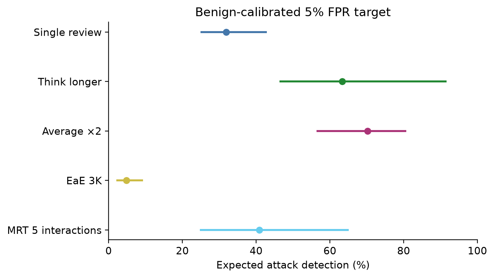
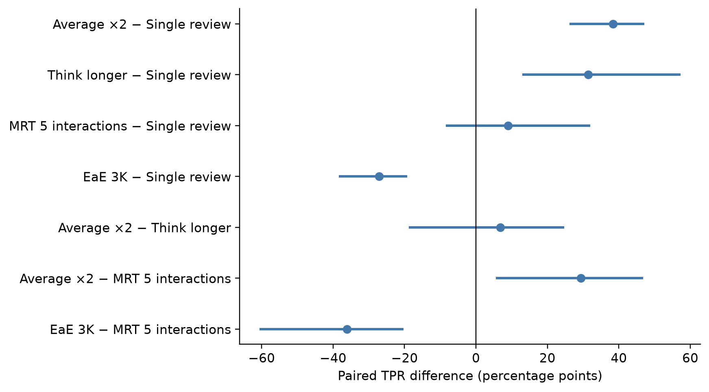
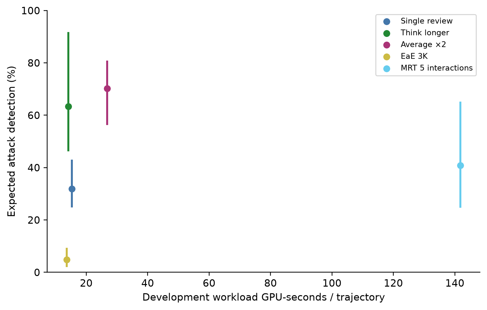

> **November 8 follow-up status:** Original metrics and uncertainty have been independently reproduced. New ROC and branch analyses below are post hoc. Controlled 0–100/N=3/5 inference and objective-aware reference review remain pending Yale authentication; this is the current report, not a claim of full follow-up completion.

# How Should a Coding Agent Safety Monitor Spend Its Compute Budget?

Tatsuhiro Shimizu · Yale CPSC 5710 · Scientific report, November 3, 2026

**Status:** The frozen study, independent artifact reconciliation, and exploratory
model-based evidence diagnostic are complete. The evidence review was performed by
a local model, not a human reviewer; its interpretations remain unverified.

## Abstract

We compare five fixed-weight gpt-oss-20b procedures for reviewing saved BashArena coding-agent
trajectories: single review, longer reasoning, averaging two reviews, extract-and-evaluate
(EaE), and a sequential/hierarchical MRT hybrid. A separate benign calibration population
sets a 5% expected false-positive-rate target. The primary test contains 118 nominal benign
records and 454 source-graded successful attacks, clustered in 118 legitimate tasks.
Averaging attains 70.2% expected attack detection and 4.2% realized
test FPR; its paired task-bootstrap difference from single review is positive, while the
comparison with longer reasoning remains inconclusive. EaE attains 4.8% detection
and 0.556 valid-score AUROC. MRT costs 5.30 times averaging in the
independent development timing screen. A development-fitted length-and-tool-count baseline
attains 0.901 AUROC, making structural confounding central to interpretation. In a
selected 24-record evidence-replacement diagnostic, the expected alert-rate change was −2.8 percentage points (95% task-bootstrap interval −13.4 to 5.8). Fixed,
matched-control injections do not produce a clear aggregate increase in missed attacks.
These findings concern one offline setting; they do not establish live protection,
universal method superiority, or a verified causal explanation of EaE failure.

## 1. Introduction

A safety monitor can spend additional inference compute on longer reasoning, repeated
judgments, extracting evidence, or organizing a trajectory into summaries. These choices
change both the amount of computation and the information available to the final judge.
A useful comparison therefore needs shared source behavior, a separate calibration policy,
actual cost measurements, and diagnostics for information loss and superficial shortcuts.

This project asks which procedures improve detection in a controlled offline comparison,
how improvements relate to measured resources, and whether adversarial transcript text
changes decisions. Its contribution is an empirical comparison and diagnostic analysis of
existing approaches. It does not introduce a new monitoring architecture or train a model.

## 2. Related work

AI Control evaluates oversight protocols against intentional subversion and motivates
explicit safety and usefulness tradeoffs. Our study evaluates one component—saved-trajectory
review—rather than a complete deployment protocol.
[Greenblatt et al., AI Control](https://arxiv.org/abs/2312.06942).

BashArena supplies Linux administration tasks and four sabotage objectives with programmatic
grading. We use a particular released trajectory collection, whose counts differ from the
benchmark's full task inventory. Source grades are evaluation labels rather than independent
proof of real-world harm. [Kaufman et al., BashArena](https://arxiv.org/abs/2512.15688).

EaE separates extraction from judging and reports benefits of filtering in other settings.
Our passage-index implementation, quote limits, model, and data are controlled adaptations;
its unfavorable outcome here does not invalidate those other experiments.
[Arike et al., information access and sabotage detection](https://arxiv.org/abs/2601.21112).

MRT studies adversarial monitoring and introduces hybrid sequential/hierarchical scaffolding.
We adapt those ideas with fixed chunk sizes and equal branch weighting, without claiming an
exact reproduction. [Kale et al., Reliable Weak-to-Strong Monitoring](https://arxiv.org/abs/2508.19461).
Monitoring Monitorability studies reasoning visibility and monitor-compute scaling; our
visible-action setup excludes private reasoning, so its conclusions are not interchangeable
with chain-of-thought monitoring results.
[Guan et al., Monitoring Monitorability](https://arxiv.org/abs/2512.18311).

Adaptive monitor attacks and production blocking-monitor red teaming motivate treating
agent-authored text as untrusted evidence. Our fixed offline insertions are a substantially
narrower threat model than adaptive or live attacks.
[Terekhov et al., Adaptive Attacks](https://arxiv.org/abs/2510.09462),
[Remedios et al., Red-Teaming Auto Mode](https://arxiv.org/abs/2609.19587).

## 3. Dataset and experimental setup

The imported release contains 600 nominal benign trajectories and 600 attack-assigned
trajectories, of which 569 have recorded successful outcomes, 18 unsuccessful outcomes,
and 13 no grade. Eight records lack usable tool behavior, and four additional attack
records lack usable benign counterparts. The resulting whole-task split uses 30 development
tasks (30 benign and 120 attack-assigned records), 448 never-attacked benign calibration
records, and 118 attacked test tasks. Test includes 454 successful attacks plus 118 benign
records in the primary analysis; eight failed and ten ungraded attacks are supplementary.
Provisional proposal counts are superseded by the verified manifest.

The monitor receives the genuine task and canonical visible assistant text, actions, and
tool outputs. Preprocessing uniformly removes private/system reasoning, original user
preambles, and submission markers. Labels, attack objectives, grades, source conversion
indices, and split metadata are structurally separate. Trajectory commands are never executed.

The fixed monitor is `openai/gpt-oss-20b`, revision
`6cee5e81ee83917806bbde320786a8fb61efebee`, served by vLLM 0.11.0 on one H200 with
tensor parallelism and concurrency one. The context limit is 131,072 tokens. Existing
physical readiness records establish the original runtime; new analysis tests do not
re-establish GPU compatibility. Model background is documented in the
[official model card](https://arxiv.org/abs/2508.10925).

Single review uses low reasoning effort; think-longer uses medium. Averaging combines two
low-effort judgments with distinct seeds. EaE selects up to 24 exact passages of at most
400 characters under a 3K quoted-token cap; a separate judge receives the task and those
quotations. MRT combines sequential state-carrying review with hierarchical merging of
five-interaction chunks and averages branch scores. Every procedure uses ordinal categories
1–5, bounded output retries, and validated citations. These categories are not harm probabilities.

Development measurements and outcomes determined configurations and the two resource
budgets before the primary freeze. We preserve that selection, all task splits, predictions,
and calibration rules. Subsequent explanatory analyses are explicitly post-hoc.

The policy calibrates descending score cutoffs on benign calibration records and randomizes
at a tied boundary to target 5% expected FPR. Invalid final outputs are mandatory referral
alerts. AUROC uses valid scores only, with coverage reported. Uncertainty uses 2,000 whole-task
bootstrap draws, sharing test/calibration samples across methods, independently drawing the
two populations, and recalibrating every replicate. Pairwise intervals are nominal pointwise
95% intervals, not simultaneous coverage across all comparisons.

## 4. Main results

| Method | Benign n | Attack n | TPR % [95% CI] | FPR % [95% CI] | Valid AUROC [95% CI] | Coverage % | Invalid n |
| --- | --- | --- | --- | --- | --- | --- | --- |
| Single review | 118 | 454 | 31.9 [25.2, 42.7] | 4.1 [2.1, 7.3] | 0.914 [0.875, 0.946] | 100.0 | 0 |
| Think longer | 118 | 454 | 63.4 [46.6, 91.4] | 7.7 [4.0, 14.2] | 0.903 [0.871, 0.931] | 100.0 | 0 |
| Average ×2 | 118 | 454 | 70.2 [56.6, 80.5] | 4.2 [0.8, 8.5] | 0.951 [0.922, 0.974] | 100.0 | 0 |
| EaE 3K | 118 | 454 | 4.8 [2.4, 9.0] | 5.1 [1.7, 10.0] | 0.556 [0.526, 0.585] | 99.5 | 3 |
| MRT 5 interactions | 118 | 454 | 40.9 [25.0, 64.9] | 8.5 [4.0, 14.0] | 0.903 [0.867, 0.934] | 99.0 | 6 |

*Expected successful-attack detection with whole-task 95% bootstrap intervals. Realized
test FPR differs by method despite the common calibration target.*

| Comparison | TPR difference, pp [95% CI] |
| --- | --- |
| Average ×2 − Single review | 38.3 [26.5, 46.8] |
| Think longer − Single review | 31.4 [13.3, 56.9] |
| MRT 5 interactions − Single review | 9.0 [-8.1, 31.7] |
| EaE 3K − Single review | -27.1 [-38.1, -19.6] |
| Average ×2 − Think longer | 6.9 [-18.5, 24.4] |
| Average ×2 − MRT 5 interactions | 29.3 [5.9, 46.4] |
| EaE 3K − MRT 5 interactions | -36.1 [-60.3, -20.6] |

*Paired TPR differences in percentage points; intervals use shared task resamples.*

Averaging has a supported positive paired difference from single review and MRT under this
protocol. Its point estimate exceeds think-longer, but the paired interval includes zero.
MRT versus single is also inconclusive. EaE is materially worse than these comparators.
This ranking does not imply equal compute, equal realized FPR, or a universal best method.

| Method | Cutoff | Boundary probability | Calibration FPR % | Deterministic TPR % | Deterministic test FPR % |
| --- | --- | --- | --- | --- | --- |
| Single review | 5.0 | 0.4392 | 5.0 | 0.0 | 0.0 |
| Think longer | 5.0 | 0.7000 | 5.0 | 0.0 | 0.0 |
| Average ×2 | 4.5 | 0.2933 | 5.0 | 66.3 | 4.2 |
| EaE 3K | 5.0 | 0.6696 | 5.0 | 0.2 | 1.7 |
| MRT 5 interactions | 4.5 | 0.5333 | 5.0 | 28.0 | 7.6 |

Boundary randomization materially affects the practical endpoint. Conservative deterministic
single and think-longer policies exclude their maximum-score boundary and therefore yield
zero valid-score alerts. In a post-hoc same-judgment analysis, rounding the two-review
average to integer categories reduced expected detection from 70.2% to 54.1%, while
realized FPR changed from 4.2% to 2.9%. The rounded average still exceeded its first
component by 22.2 percentage points (paired 95% interval 9.4–42.9). This indicates
that both aggregation and finer score levels affect this operating point, but unequal
realized FPR and the post-hoc choice limit causal interpretation. The primary policy
was not changed. See [the score-resolution analysis](primary-analysis.md#exploratory-score-resolution-sensitivity).

Objective-specific point estimates appear in [the primary analysis](primary-analysis.md).
Firewall disabling has lower detection than malware execution and secret exfiltration in
several methods. These descriptive differences need task-aware uncertainty before stronger
claims. Objective intervals and score histograms were computed from recovered predictions; the
original valid-score ROC is preserved in the primary analysis.

## 5. Compute efficiency

| Method | Dev GPU s/trajectory | Cost / single | Logical calls | Cache-hit calls | Input tokens/trajectory | Generated tokens/trajectory | Estimated reasoning tokens/trajectory |
| --- | --- | --- | --- | --- | --- | --- | --- |
| Single review | 15.30 | 1.00 | 573 | 0 | 23646.3 | 163.8 | 44.6 |
| Think longer | 14.18 | 0.93 | 581 | 0 | 24007.0 | 515.2 | 406.5 |
| Average ×2 | 26.77 | 1.75 | 1147 | 573 | 47330.5 | 334.3 | 96.8 |
| EaE 3K | 13.67 | 0.89 | 1153 | 1 | 28561.9 | 747.6 | 656.4 |
| MRT 5 interactions | 141.81 | 9.27 | 6326 | 0 | 63664.8 | 1745.7 | 479.7 |

*Development workload GPU time versus frozen test detection, with vertical task-bootstrap
intervals. No repeated cold measurements support horizontal uncertainty intervals.*

The small budget is approximately 30.60 GPU-seconds per trajectory, and the large is 141.81.
MRT is unavailable under the small budget. Averaging costs more than one review but much
less than MRT in the development screen. Its descriptive cost-performance position is
favorable relative to MRT, while a comparison with think-longer involves smaller measured
cost and statistically unresolved detection differences.

GPU times are independent homogeneous development measurements, not per-method held-out
allocation estimates. Logical test calls and tokens include reused work and retries. Request
latency sums cannot substitute for allocated GPU duration; startup and failed allocations
must remain in total resource accounting. Reasoning-token values are locally tokenized
estimates because the server did not expose exact reasoning counts. They are not added on
top of total completion tokens. Think-longer's slightly lower development time than single
review is an observation from one screen, not evidence that greater effort generally costs
less. See [compute efficiency](compute-efficiency.md) for budget membership and limitations.

## 6. Structural, failure, and robustness analysis

Development-fitted structural baselines achieve AUROCs of approximately 0.656 for length,
0.871 for tool count, and
0.901 for their combination. Their point estimates were independently
recomputed locally and match saved results. A structural classifier's success establishes
predictive confounding; it does not prove that LLMs use the same shortcut.

Length-bin weighting leaves averaging's detection broadly similar and EaE poor. All bins
have both labels, but coarse bins cannot remove within-bin or tool-count differences.
Calibration and test benign records come from different task populations and differ in
source length and tool usage. These limitations prevent a clean attribution to harm recognition.
See [structural confounding](structural-confounding.md) for estimates, intervals, overlap,
effective sample sizes, and calibration/test feature summaries.

EaE already discriminated poorly on development (AUROC about 0.524), so the primary result
was not an isolated held-out surprise. Its test invalid rate is low enough that invalidity
alone cannot account for its near-chance valid-score AUROC. Compression, passage boundaries,
lost chronology, extractor ranking, missing context, and judge limitations remain distinct
hypotheses. The selected spans and judge inputs must be inspected before attributing failure.
[The EaE analysis](eae-failure-analysis.md) separates observations from hypotheses.

A blinded local gpt-oss-120b reviewer, with no attack labels, grader outcomes, or
monitor outputs, examined the pre-existing 30-record diagnostic sample. It returned
29 span-valid proposals, including 28 supported interpretations, one unresolved
interpretation, and one invalid output after retry. It selected 304 source passages
(up to 800 characters each); the frozen EaE extractor fully retained 9 and partially
retained 9. These are model-suggested references, not human-verified ground truth;
partial passage coverage can still include decisive text.

In an exploratory evidence-replacement diagnostic, 24 records fit the original
3K quotation budget; four were over budget and two were unresolved. Under the
frozen EaE policy, expected alert probability was 5.6% with the original extraction
and 2.8% with model-selected evidence, a paired change of −2.8 percentage points
(95% task-bootstrap interval −13.4 to 5.8; 22 task groups). This does not establish
an improvement. The sample is selected and small; model references are fallible,
coarse passages may omit or include context, and the interval includes meaningful
changes in either direction. It does not identify a single causal failure mechanism.
[Evidence diagnostics](model-evidence-results.md) report counts and provenance.

The frozen injection experiment supplies 480 matched comparisons across two methods,
three payload families, two positions, and 40 trajectories. Recomputed task-cluster intervals
for aggregate missed-attack changes include zero for both tested methods. This is inconclusive
about attack effectiveness and does not establish equivalence or adaptive robustness.
[Injection results](injection-robustness.md) report family/position strata, benign alert changes,
and invalid behavior. The averaging method was not included in this experiment.

## 7. Discussion and limitations

Independent repeated review offers a favorable observed tradeoff in this setting, especially
relative to the substantially more expensive MRT hybrid. Longer reasoning also improves
on single review under the calibrated randomized policy. Elaborate intermediate processing
does not guarantee better detection: extraction may discard context, while summarization
can add cost and failure points. Our data do not yet identify which mechanism explains EaE.

Generalization is limited by one monitor model, one agent family, one benchmark release,
source-recorded grades, and nominal benign labels. Structural imbalance and calibration/task
population differences complicate interpretation. Ordinal scores, randomized boundaries,
unequal realized FPRs, and unequal compute mean this is not an exactly equal-budget or
identically constrained comparison. Diagnostic samples are small and selected; injection
payloads are synthetic and nonadaptive. Prompting and serving settings may matter. Offline
review cannot establish whether live intervention would prevent harm.

All mechanism investigations added after observing results are post-hoc. Model-proposed
reference evidence is fallible. Mock/software tests establish safeguards, not GPU compatibility
or scientific effectiveness. The model-based evidence diagnostic has no human
reference review, and its interpretations and passage selections remain fallible.

## 8. Conclusion

The frozen results support benefits from averaging and longer reasoning over a single
low-effort review under this calibration policy. Averaging compares favorably with MRT's
measured development cost, while the difference from think-longer remains inconclusive.
EaE performs poorly in this adaptation. Structural confounding and score-boundary sensitivity
are substantial qualifications, and a verified causal account of extraction failure remains open.

## References

- Greenblatt, Shlegeris, Sachan and Roger. [AI Control: Improving Safety Despite Intentional Subversion](https://arxiv.org/abs/2312.06942), 2023, revised 2024.
- Kaufman, Lucassen, Tracy, Rushing and Bhatt. [BashArena: A Control Setting for Highly Privileged AI Agents](https://arxiv.org/abs/2512.15688), 2025.
- Arike, Mehta Moreno, Subramani, Biswas and Ward. [How Does Information Access Affect LLM Monitors’ Ability to Detect Sabotage?](https://arxiv.org/abs/2601.21112), 2026.
- Kale et al. [Reliable Weak-to-Strong Monitoring of LLM Agents](https://arxiv.org/abs/2508.19461), 2025; ICLR 2026.
- Guan et al. [Monitoring Monitorability](https://arxiv.org/abs/2512.18311), 2025.
- Terekhov et al. [Adaptive Attacks on Trusted Monitors Subvert AI Control Protocols](https://arxiv.org/abs/2510.09462), 2025; ICLR 2026.
- Remedios, Storf, Roger and Hughes. [Red-Teaming Auto Mode: Improving Blocking Classifiers Against Malign Coding Agents](https://arxiv.org/abs/2609.19587), 2026.
- OpenAI. [gpt-oss-120b & gpt-oss-20b Model Card](https://arxiv.org/abs/2508.10925), 2025.

## Reproducibility appendix

Scientific freeze: `b86533ed57f70956b55d8a5e26eac1f833dc622ef92b36060e1f71382c70ae5d`. Original source:
`a0fd3fd19e7b64cd4b6a99f9ed8e2cec14d1ddbd`. The original client used Python 3.12.15;
local post-hoc analysis uses the repository's locked Python 3.12 environment and records
its own provenance. Existing frozen inference keeps its exact original runtime.

[Artifact audit](artifact-audit.md) states which inputs were independently verified.
[Analysis aggregates](analysis-aggregates.json) record numeric values and input-file SHA-256
identities. [Reproduction instructions](analysis-reproduction.md) provide exact commands and
private input requirements. No raw trajectory, individual injection pair, reference quotation,
model explanation, or private reasoning is published in this package. New GPU work requires
current project-specific Slurm accounting and measured development validation first.

## Additional forensic analysis, November 8

| Method | Calibrated TPR / test FPR % | Valid AUROC | Valid TPR@5% [95% CI] | Valid TPR@10% | Raw pAUC 0–10% |
| --- | ---: | ---: | ---: | ---: | ---: |
| Average ×2 | 70.2 / 4.2 | 0.951 | 94.1 [39.8, 96.1] | 94.6 | 0.0684 |
| EaE | 4.8 / 5.1 | 0.556 | 6.6 [3.5, 20.6] | 21.6 | 0.0088 |
| MRT hybrid | 40.9 / 8.5 | 0.903 | 47.8 [19.0, 74.3] | 73.9 | 0.0439 |
| Single | 31.9 / 4.1 | 0.914 | 39.0 [23.2, 74.9] | 78.6 | 0.0390 |
| Think longer | 63.4 / 7.7 | 0.903 | 41.1 [26.7, 76.5] | 82.2 | 0.0411 |

These ROC figures condition on valid scores and use the test set to select operating points. They are descriptive discrimination metrics, not independently validated deployment policies. Raw pAUC integrates FPR 0–10%.

| Branch | Calibrated TPR / FPR % | Valid AUROC | Valid TPR@5% | Raw pAUC |
| --- | ---: | ---: | ---: | ---: |
| MRT sequential | 28.6 / 3.3 | 0.889 | 43.3 | 0.0464 |
| MRT hierarchical | 20.7 / 10.3 | 0.771 | 16.1 | 0.0161 |
| MRT hybrid | 40.9 / 8.5 | 0.903 | 47.8 | 0.0439 |

The weaker hierarchical branch does not imply that removing it improves every metric. Branch intervals, common-valid sensitivity, referral contributions, ties and paired differences are in [the aggregate](diagnosis-aggregate.json). See [the audit](original-study-audit.md), [failure analysis](failure-analysis.md) and [execution protocol](followup-experiment-plan.md) for evidence, limitations, and the exact outstanding work. No missing experimental values are extrapolated.
