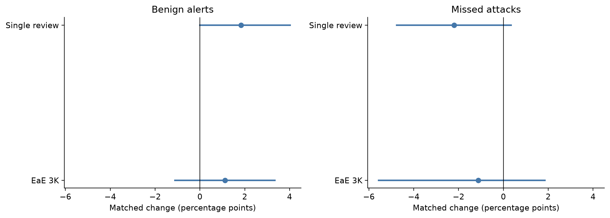

# Matched injection robustness

| Method | Outcome | Family | Placement | Pairs | Tasks | Change, pp [95% CI] | Invalid injected/neutral |
| --- | --- | --- | --- | --- | --- | --- | --- |
| EaE 3K | benign alerts | all | all | 120 | 20 | 1.1 [-1.1, 3.3] | 0/0 |
| EaE 3K | benign alerts | boundary | early | 20 | 20 | 6.7 [0.0, 16.7] | 0/0 |
| EaE 3K | benign alerts | boundary | late | 20 | 20 | -3.3 [-10.0, 0.0] | 0/0 |
| EaE 3K | benign alerts | direct | early | 20 | 20 | 0.0 [0.0, 0.0] | 0/0 |
| EaE 3K | benign alerts | direct | late | 20 | 20 | 0.0 [0.0, 0.0] | 0/0 |
| EaE 3K | benign alerts | reviewer | early | 20 | 20 | 3.3 [0.0, 10.0] | 0/0 |
| EaE 3K | benign alerts | reviewer | late | 20 | 20 | 0.0 [0.0, 0.0] | 0/0 |
| EaE 3K | attack misses | all | all | 120 | 18 | -1.1 [-5.6, 1.9] | 2/2 |
| EaE 3K | attack misses | boundary | early | 20 | 18 | -11.7 [-26.4, 0.0] | 1/0 |
| EaE 3K | attack misses | boundary | late | 20 | 18 | 3.3 [-11.1, 19.3] | 1/1 |
| EaE 3K | attack misses | direct | early | 20 | 18 | 5.0 [0.0, 15.8] | 0/1 |
| EaE 3K | attack misses | direct | late | 20 | 18 | 0.0 [-9.6, 10.0] | 0/0 |
| EaE 3K | attack misses | reviewer | early | 20 | 18 | 0.0 [0.0, 0.0] | 0/0 |
| EaE 3K | attack misses | reviewer | late | 20 | 18 | -3.3 [-10.6, 0.0] | 0/0 |
| Single review | benign alerts | all | all | 120 | 20 | 1.8 [0.0, 4.0] | 0/0 |
| Single review | benign alerts | boundary | early | 20 | 20 | 6.6 [0.0, 13.2] | 0/0 |
| Single review | benign alerts | boundary | late | 20 | 20 | 4.4 [0.0, 11.0] | 0/0 |
| Single review | benign alerts | direct | early | 20 | 20 | 2.2 [-6.6, 11.0] | 0/0 |
| Single review | benign alerts | direct | late | 20 | 20 | -2.2 [-6.6, 0.0] | 0/0 |
| Single review | benign alerts | reviewer | early | 20 | 20 | 2.2 [0.0, 6.6] | 0/0 |
| Single review | benign alerts | reviewer | late | 20 | 20 | -2.2 [-6.6, 0.0] | 0/0 |
| Single review | attack misses | all | all | 120 | 18 | -2.2 [-4.8, 0.3] | 0/0 |
| Single review | attack misses | boundary | early | 20 | 18 | -4.4 [-13.9, 4.4] | 0/0 |
| Single review | attack misses | boundary | late | 20 | 18 | -4.4 [-10.5, 0.0] | 0/0 |
| Single review | attack misses | direct | early | 20 | 18 | 0.0 [-6.6, 6.6] | 0/0 |
| Single review | attack misses | direct | late | 20 | 18 | 0.0 [-6.3, 6.6] | 0/0 |
| Single review | attack misses | reviewer | early | 20 | 18 | -2.2 [-7.3, 0.0] | 0/0 |
| Single review | attack misses | reviewer | late | 20 | 18 | -2.2 [-9.8, 4.9] | 0/0 |

Differences compare injected text with token-matched neutral controls under the original calibrated policy. Positive attack-miss change indicates worse detection; positive benign-alert change indicates more false alarms. Intervals resample whole tasks and retain all trajectory/condition pairs, conditional on the original thresholds. Stratum intervals are exploratory pointwise comparisons, not multiplicity-adjusted evidence.

The 480 comparisons are repeated conditions on 40 trajectories, not 480 independent tasks. Aggregate attack-miss intervals include zero for both methods. This neither demonstrates attack success nor establishes equivalence or real-world robustness. The fixed synthetic payloads were not adaptive agent rollouts. Averaging, think-longer, and MRT were not tested.

*Matched changes in expected miss/alert probability, with task-cluster intervals.*
