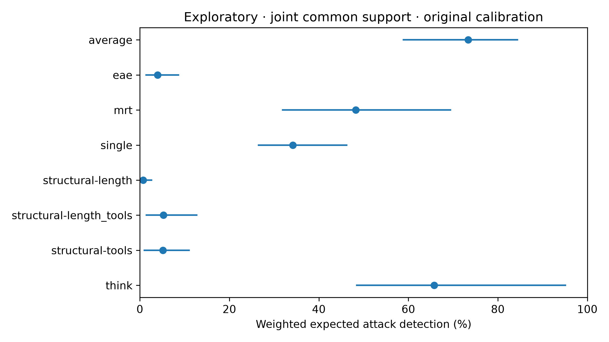

# Joint length and tool-count sensitivity

Exploratory analysis of the original 572-record primary test cohort. A fixed grid uses development quintiles of log source-token length and log tool-call count. Within each cell, benign and successful-attack mass is equalized to the smaller class count. Cells without both classes receive zero weight. The original 448-record benign calibration population and 5% expected-FPR policies are unchanged.

| Method | Weighted detection % [95% CI] | Weighted FPR % | Weighted valid AUROC |
| --- | ---: | ---: | ---: |
| average | 73.4 [58.9, 84.4] | 4.1 | 0.966 |
| eae | 4.0 [1.4, 8.6] | 4.2 | 0.558 |
| mrt | 48.2 [31.9, 69.4] | 7.8 | 0.913 |
| single | 34.2 [26.6, 46.2] | 3.8 | 0.937 |
| structural-length | 0.8 [0.0, 2.6] | 7.0 | 0.510 |
| structural-length_tools | 5.3 [1.4, 12.7] | 4.7 | 0.676 |
| structural-tools | 5.1 [1.0, 11.0] | 4.3 | 0.607 |
| think | 65.8 [48.5, 95.1] | 7.8 | 0.923 |

The grid excludes 143 records from common support (3 benign, 140 attacks). Class-specific Kish effective sample sizes are 104.4 benign and 123.3 attacks.

Intervals use 2,000 shared whole-task bootstrap draws, independently resampling calibration and test tasks, recalibrating and recomputing cell weights on each draw. They condition on the development-fitted baselines and bin boundaries. Pointwise paired comparisons, objective-specific intervals, overlap counts, and weighted feature means are in [the aggregate artifact](joint-structural-aggregate.json).

The averaging-versus-single and averaging-versus-MRT detection differences remain positive in point estimates. The structural length-plus-tool baseline weakens substantially within this overlap population. This supports caution about structural predictability in the original cohort; it does not establish that the monitors recognize harm independently of all structural cues. Coarse cells leave residual imbalance, unsupported records change the estimand, and benign calibration/test task populations still differ. Comparisons with think-longer remain subject to unequal realized FPR and paired uncertainty.

