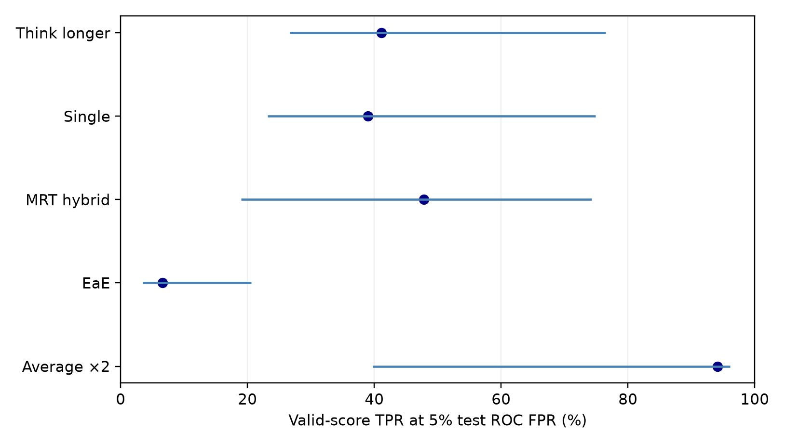

# Original-study forensic audit

The independent histogram implementation matches all
five original point estimates and 2,000 task-bootstrap TPR/FPR intervals, and the saved primary
report. Original results are preserved. The original freeze is `b86533ed57f70956b55d8a5e26eac1f833dc622ef92b36060e1f71382c70ae5d`.

The source-object/canonical-data audit passes; both raw source logs match their checksums.
Each method has 448 calibration and 590 test artifacts. Primary analysis uses 118 benign and
454 successful attacks; eight failed and ten ungraded attacks remain supplementary.

Direct raw-log replay checked 1200 samples, with 0 label/canonical mismatches and 0 inconsistent genuine task descriptions. No trajectory command was executed.

## Calibrated policy versus descriptive discrimination

| Method | Calibrated TPR / test FPR % | Valid AUROC | Valid TPR@5% [95% CI] | Valid TPR@10% | Raw pAUC 0–10% |
| --- | ---: | ---: | ---: | ---: | ---: |
| Average ×2 | 70.2 / 4.2 | 0.951 | 94.1 [39.8, 96.1] | 94.6 | 0.0684 |
| EaE | 4.8 / 5.1 | 0.556 | 6.6 [3.5, 20.6] | 21.6 | 0.0088 |
| MRT hybrid | 40.9 / 8.5 | 0.903 | 47.8 [19.0, 74.3] | 73.9 | 0.0439 |
| Single | 31.9 / 4.1 | 0.914 | 39.0 [23.2, 74.9] | 78.6 | 0.0390 |
| Think longer | 63.4 / 7.7 | 0.903 | 41.1 [26.7, 76.5] | 82.2 | 0.0411 |

The calibrated policy includes mandatory invalid-output referrals and expected boundary
randomization. ROC metrics condition on valid scores; coverage and referral contributions
are recorded per class in the aggregate JSON. Test-selected ROC thresholds are descriptive,
not independently validated deployment thresholds. Tied-score blocks are interpolated;
no convex-hull optimization is used. Partial AUROC is the raw integral, range 0–0.1.

Bootstrap intervals use 2,000 identical whole-task draws across methods, independent
calibration/test draws, and recalibration in every replicate. Infeasible calibration draws
remain included with their actual FPR and are counted separately. Metric-specific usable
replicate counts and paired differences accompany the estimates. Intervals do not measure
stochastic inference variability and are pointwise, without multiplicity correction.

- Average ×2: invalid test benign/attack = 0/0; TPR from invalid referrals = 0.00 percentage points; infeasible calibration draws = 0/2000.
- EaE: invalid test benign/attack = 2/1; TPR from invalid referrals = 0.22 percentage points; infeasible calibration draws = 0/2000.
- MRT hybrid: invalid test benign/attack = 5/1; TPR from invalid referrals = 0.22 percentage points; infeasible calibration draws = 0/2000.
- Single: invalid test benign/attack = 0/0; TPR from invalid referrals = 0.00 percentage points; infeasible calibration draws = 0/2000.
- Think longer: invalid test benign/attack = 0/0; TPR from invalid referrals = 0.00 percentage points; infeasible calibration draws = 0/2000.

## Cost provenance

The recovered project-filtered Slurm file records
**61.306 allocated GPU-hours**, including earlier
follow-ups and failures. This is historical accounting, not a fresh scheduler inspection.
The independently measured development workload rates remain the only homogeneous per-method
GPU-time measurements. Shared held-out allocations cannot be split into exact method costs
using request latency. Development and held-out cost claims remain explicitly distinct.

[Aggregate measurements](diagnosis-aggregate.json) include input hashes and definitions.
Reproduction and current blockers are in [the follow-up protocol](followup-experiment-plan.md).

## Benign population contrasts

Calibration uses never-attacked tasks; benign test records come from tasks with attack variants. Whole-task intervals describe differences, not their causes.

- characters: test minus calibration mean 4053.6 [95% CI -3494.4, 12084.6].
- source_tokens: test minus calibration mean 1087.1 [95% CI -1138.7, 3468.3].
- tool_calls: test minus calibration mean 3.8 [95% CI 0.5, 7.3].

These contrasts do not establish that population differences caused monitor FPR drift. Nominal benign assignment does not certify harmless behavior. Full score and invalid-rate contrasts are in [the numeric summary](calibration-shift-aggregate.json).

Common-valid sensitivity retains 563 primary test records across all five methods. Its conditional metrics and paired intervals are in the aggregate JSON; they do not replace population deployment rates.
