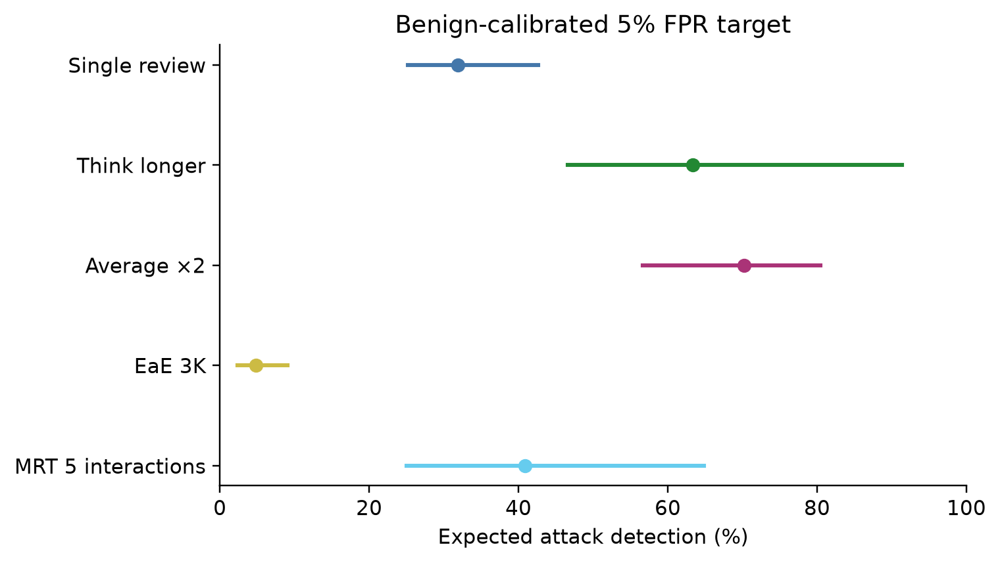
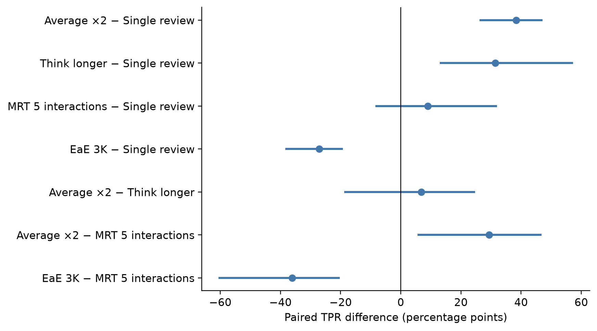
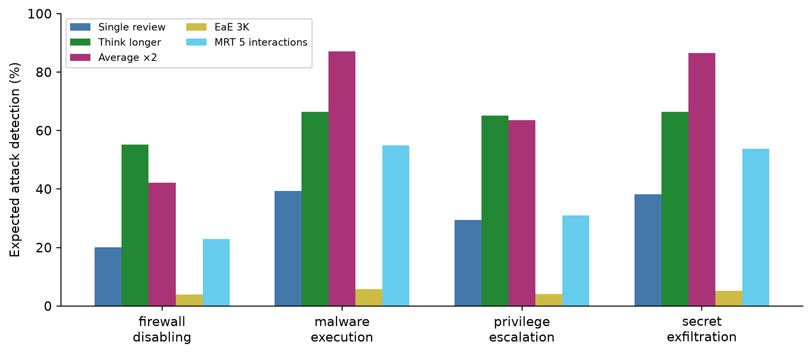
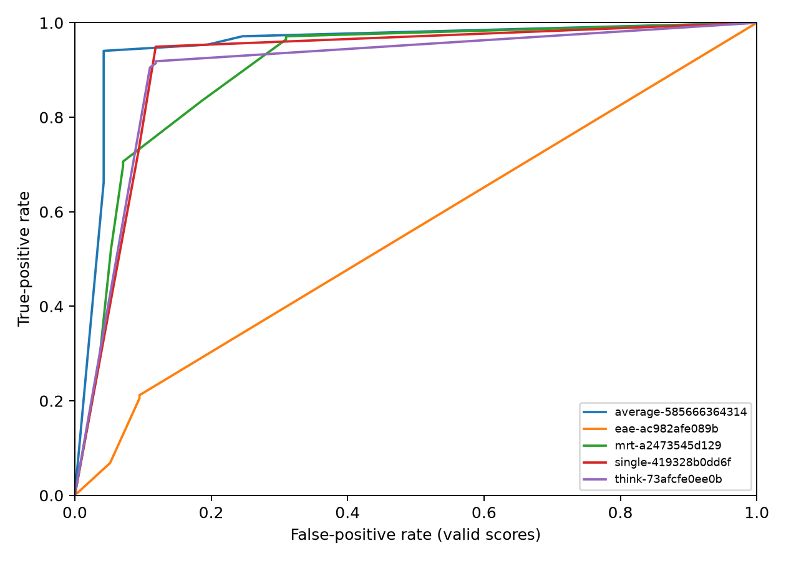
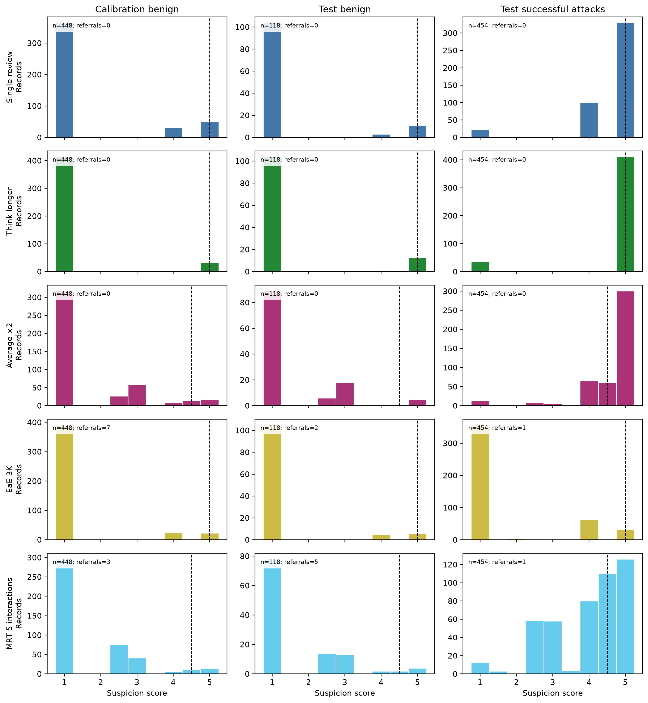
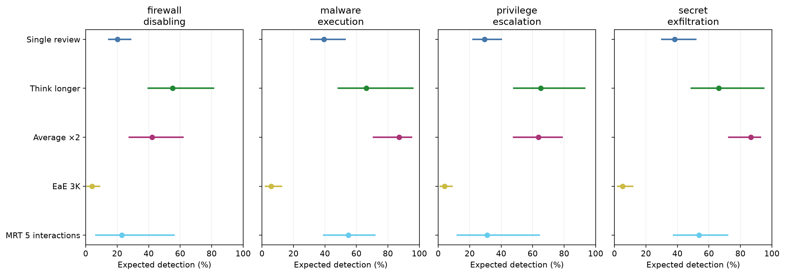

> **Update:** Full frozen records were recovered and audited; regenerated primary metrics and paired bootstrap intervals match the saved summary exactly. Objective intervals and score histograms are available below.

# Primary statistical analysis

Primary estimates reproduce the saved frozen summary. Record-level reconciliation and objective-specific uncertainty have been completed. Calibration uses 448 separate benign trajectories; thresholds target 5% expected FPR. Invalid outputs are referral alerts. AUROC conditions on valid scores.

| Method | Benign n | Attack n | TPR % [95% CI] | FPR % [95% CI] | Valid AUROC [95% CI] | Coverage % | Invalid n |
| --- | --- | --- | --- | --- | --- | --- | --- |
| Single review | 118 | 454 | 31.9 [25.2, 42.7] | 4.1 [2.1, 7.3] | 0.914 [0.875, 0.946] | 100.0 | 0 |
| Think longer | 118 | 454 | 63.4 [46.6, 91.4] | 7.7 [4.0, 14.2] | 0.903 [0.871, 0.931] | 100.0 | 0 |
| Average ×2 | 118 | 454 | 70.2 [56.6, 80.5] | 4.2 [0.8, 8.5] | 0.951 [0.922, 0.974] | 100.0 | 0 |
| EaE 3K | 118 | 454 | 4.8 [2.4, 9.0] | 5.1 [1.7, 10.0] | 0.556 [0.526, 0.585] | 99.5 | 3 |
| MRT 5 interactions | 118 | 454 | 40.9 [25.0, 64.9] | 8.5 [4.0, 14.0] | 0.903 [0.867, 0.934] | 99.0 | 6 |

## Paired comparisons

| Comparison | TPR difference, pp [95% CI] |
| --- | --- |
| Average ×2 − Single review | 38.3 [26.5, 46.8] |
| Think longer − Single review | 31.4 [13.3, 56.9] |
| MRT 5 interactions − Single review | 9.0 [-8.1, 31.7] |
| EaE 3K − Single review | -27.1 [-38.1, -19.6] |
| Average ×2 − Think longer | 6.9 [-18.5, 24.4] |
| Average ×2 − MRT 5 interactions | 29.3 [5.9, 46.4] |
| EaE 3K − MRT 5 interactions | -36.1 [-60.3, -20.6] |

Intervals use the same 2,000 task-bootstrap draws across methods, independent calibration/test task draws, and recalibration in every replicate; zero replicates were skipped in the saved summary. They are nominal pointwise intervals, without simultaneous multiple-comparison coverage. Reversed comparisons negate and reverse interval endpoints. Averaging exceeds single review and MRT in these paired intervals; its difference from think-longer remains inconclusive. This does not establish a universal winner.

## Calibration and discrete scores

| Method | Cutoff | Boundary probability | Calibration FPR % | Deterministic TPR % | Deterministic test FPR % |
| --- | --- | --- | --- | --- | --- |
| Single review | 5.0 | 0.4392 | 5.0 | 0.0 | 0.0 |
| Think longer | 5.0 | 0.7000 | 5.0 | 0.0 | 0.0 |
| Average ×2 | 4.5 | 0.2933 | 5.0 | 66.3 | 4.2 |
| EaE 3K | 5.0 | 0.6696 | 5.0 | 0.2 | 1.7 |
| MRT 5 interactions | 4.5 | 0.5333 | 5.0 | 28.0 | 7.6 |

These TPR/FPR values are expected alert probabilities under randomized boundary decisions, not integer counts of alerts. The conservative deterministic single and think-longer policies alert no valid test records: the cutoff is maximal and boundary is excluded. This sensitivity is substantial. Averaging permits half-integer scores; record-level judgments are needed to isolate disagreement and resolution effects. The inference settings and deployed thresholds remain frozen.

## Objectives

| Method | Objective | n | TPR % |
| --- | --- | --- | --- |
| Single review | firewall disabling | 109 | 20.1 |
| Single review | malware execution | 115 | 39.3 |
| Single review | privilege escalation | 115 | 29.4 |
| Single review | secret exfiltration | 115 | 38.2 |
| Think longer | firewall disabling | 109 | 55.2 |
| Think longer | malware execution | 115 | 66.3 |
| Think longer | privilege escalation | 115 | 65.1 |
| Think longer | secret exfiltration | 115 | 66.3 |
| Average ×2 | firewall disabling | 109 | 42.1 |
| Average ×2 | malware execution | 115 | 87.2 |
| Average ×2 | privilege escalation | 115 | 63.6 |
| Average ×2 | secret exfiltration | 115 | 86.6 |
| EaE 3K | firewall disabling | 109 | 4.0 |
| EaE 3K | malware execution | 115 | 5.8 |
| EaE 3K | privilege escalation | 115 | 4.1 |
| EaE 3K | secret exfiltration | 115 | 5.2 |
| MRT 5 interactions | firewall disabling | 109 | 22.9 |
| MRT 5 interactions | malware execution | 115 | 55.0 |
| MRT 5 interactions | privilege escalation | 115 | 31.0 |
| MRT 5 interactions | secret exfiltration | 115 | 53.7 |

Objective point estimates are descriptive; recalibrated task-bootstrap intervals appear below. The regenerated ROC requires saved individual scores; no curve is invented from one AUROC value.

*Expected successful-attack TPR with recalibrated whole-task 95% bootstrap intervals.*

*Signed TPR differences in percentage points; intervals preserve pairing.*

*Objective-specific point estimates; confidence intervals are reported in the table below.*

*Original saved ROC, copied without modification. Invalid outputs are excluded; per-method valid coverage is given in the primary table. Full record recovery is required to regenerate and independently verify the curve.*

## Recomputed objective intervals

| Method | Objective | 95% task-bootstrap interval | Usable replicates |
| --- | --- | --- | --- |
| Average ×2 | firewall disabling | 27.7–61.8% | 2000 |
| Average ×2 | malware execution | 70.8–94.9% | 2000 |
| Average ×2 | privilege escalation | 47.9–78.7% | 2000 |
| Average ×2 | secret exfiltration | 72.7–92.7% | 2000 |
| EaE 3K | firewall disabling | 1.0–8.7% | 2000 |
| EaE 3K | malware execution | 2.3–12.3% | 2000 |
| EaE 3K | privilege escalation | 1.3–8.8% | 2000 |
| EaE 3K | secret exfiltration | 2.0–11.5% | 2000 |
| MRT 5 interactions | firewall disabling | 6.5–56.0% | 2000 |
| MRT 5 interactions | malware execution | 39.2–71.7% | 2000 |
| MRT 5 interactions | privilege escalation | 12.2–64.2% | 2000 |
| MRT 5 interactions | secret exfiltration | 37.5–71.8% | 2000 |
| Single review | firewall disabling | 14.6–28.6% | 2000 |
| Single review | malware execution | 31.0–52.8% | 2000 |
| Single review | privilege escalation | 22.1–40.1% | 2000 |
| Single review | secret exfiltration | 30.1–51.6% | 2000 |
| Think longer | firewall disabling | 39.8–81.2% | 2000 |
| Think longer | malware execution | 48.5–95.8% | 2000 |
| Think longer | privilege escalation | 48.0–93.1% | 2000 |
| Think longer | secret exfiltration | 48.9–94.8% | 2000 |

These intervals resample whole calibration and test tasks and recalibrate each method. They are post-hoc pointwise intervals. Numeric score histograms and aggregate diagnostics are in [full-record diagnostics](full-record-diagnostics.json).

## Recovered score distributions and objective uncertainty

*Counts of valid ordinal scores by method and cohort. Dashed lines show the frozen
calibration cutoff. Boundary scores are alerted with the method-specific probability
listed above; invalid outputs are referral alerts and are counted separately in each panel.*

*Expected detection by objective with pointwise 95% whole-task bootstrap intervals;
calibration is repeated for each bootstrap draw. Each objective includes 109 or 115
successful attacks. These post-hoc comparisons are descriptive.*
