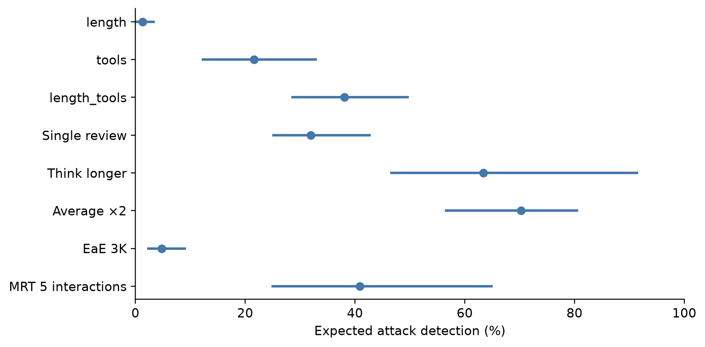
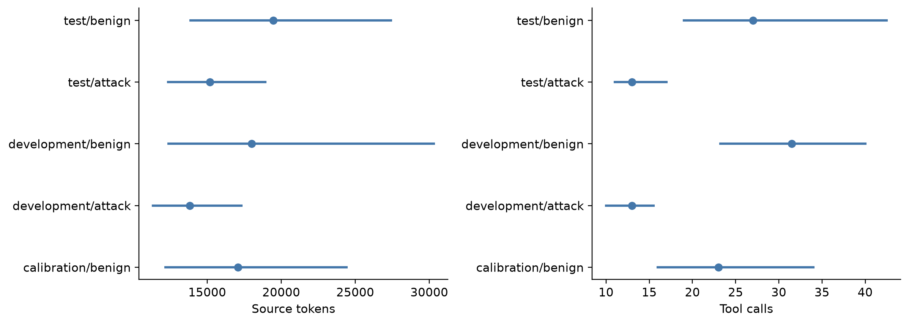

# Structural confounding

| Baseline | TPR % [95% CI] | FPR % [95% CI] | Valid AUROC |
| --- | --- | --- | --- |
| length | 1.3 [0.2, 3.3] | 5.1 [1.7, 9.3] | 0.656 |
| tools | 21.6 [12.3, 32.9] | 3.1 [0.5, 6.8] | 0.871 |
| length_tools | 38.1 [28.6, 49.6] | 3.4 [0.8, 8.5] | 0.901 |

Baselines fit only development labels using standardized log-transformed length and/or tool counts. Their stored bootstrap conditions on this fitted development model. Length-plus-tools AUROC is close to several full-transcript monitors. This establishes that structural features predict assignment well; it does not prove that the language models use those features. Harm-recognition claims must account for confounding.

| Method | Unweighted TPR % | Length-weighted TPR % [95% CI] | Weighted FPR % [95% CI] | Unsupported n |
| --- | --- | --- | --- | --- |
| Single review | 31.9 | 31.2 [24.3, 41.8] | 4.1 [2.1, 7.3] | 0 |
| Think longer | 63.4 | 63.9 [47.0, 92.0] | 7.7 [4.0, 14.2] | 0 |
| Average ×2 | 70.2 | 68.1 [54.1, 80.1] | 4.2 [0.8, 8.5] | 0 |
| EaE 3K | 4.8 | 5.0 [2.3, 9.7] | 5.1 [1.7, 10.0] | 0 |
| MRT 5 interactions | 40.9 | 42.6 [26.0, 65.7] | 8.5 [4.0, 14.0] | 0 |

Development-derived bins equalize benign and attack mass within each bin. All five bins have both classes and no test records are wholly unsupported. This coarse matching leaves within-bin differences and tool-count confounding. It is a sensitivity analysis, not causal identification. The unchanged weighted FPR follows from every bin having more attacks than benign records, leaving benign weights one. Kish effective sample sizes from saved bin weights are 118.0 benign and 293.3 attacks; bin edges remain development-derived.

Calibration benign records come from never-attacked tasks; test benign records come from attacked task groups. Their different task populations can shift scores and realized FPR. Score-distribution comparisons require full prediction recovery; the frozen calibration population will not be changed.

*Structural baseline and monitor TPR at independently benign-calibrated policies.*

## Calibration distribution shift

| Group | n | Median source tokens [IQR] | Median tool calls [IQR] |
| --- | --- | --- | --- |
| calibration/benign | 448 | 17,088.0 [12,190.8, 24,418.5] | 23.0 [16.0, 34.0] |
| development/attack | 111 | 13,820.0 [11,344.0, 17,311.0] | 13.0 [10.0, 15.5] |
| development/benign | 30 | 18,006.5 [12,377.0, 30,305.2] | 31.5 [23.2, 40.0] |
| test/attack | 454 | 15,177.5 [12,365.2, 18,916.5] | 13.0 [11.0, 17.0] |
| test/benign | 118 | 19,460.5 [13,879.2, 27,400.2] | 27.0 [19.0, 42.5] |

Source-token statistics come from the local prepared audit, not complete model prompts. Benign test trajectories are longer and have more tool calls at their medians than calibration trajectories. This is descriptive evidence of population differences; it does not establish their effect on scores.

*Source-feature medians and interquartile ranges, not confidence intervals.*
